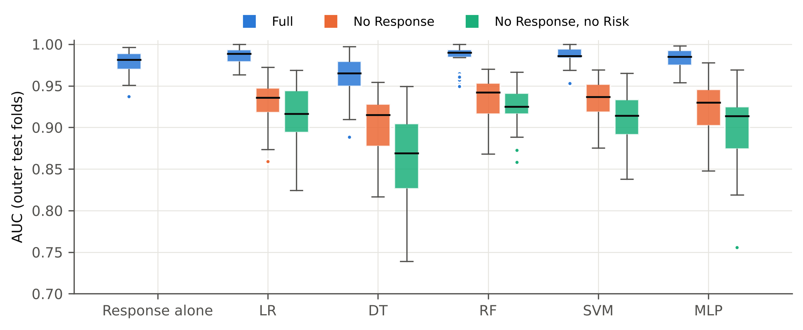

# Recurrence Prediction in Differentiated Thyroid Cancer: a Leakage-Aware Re-evaluation

[](https://www.python.org/)
[](https://scikit-learn.org/)
[](LICENSE)
[]()

Code and results for the manuscript *Re-evaluating machine learning for recurrence prediction in differentiated thyroid cancer: test-set tuning, duplicate records and a post-treatment predictor* (K. P. Mien, Erciyes University).

Many studies on the public UCI thyroid cancer recurrence dataset report accuracies close to 99%. This repository shows where those numbers come from, using repeated nested cross-validation and a simple reference: the **response to initial therapy** variable used on its own, with no model at all.

---

## Main findings

| | AUC (nested CV) | Sensitivity |
|---|---|---|
| *Response to therapy* alone, no model | 0.978 | 0.82 |
| Best model (logistic regression) | 0.987 | 0.90 |
| Logistic regression **without** *Response* | 0.931 | 0.68 |
| Random forest **without** *Response* | 0.934 | 0.76 |

- **No trained model is significantly better than *Response* alone** (corrected resampled *t*-test, all *p* > 0.05). The models mainly improve sensitivity.
- *Response* is assessed during follow-up, and its worst category (*structural incomplete*) means that disease is visible on imaging: 89 of the 91 patients in that category are labelled as recurrences.
- **Without *Response***, the AUC falls to about 0.93, which is a more realistic estimate of what can be predicted at the end of initial treatment.
- **The 98.7% accuracy of the original analysis** (see `original/`) is reproduced only when hyperparameters are chosen on the test set. Tuned on the training set, the same split gives 97.4%, and accuracy over 50 random splits ranges from 89.6% to 100%.
- The dataset contains **19 exact duplicate rows** (all non-recurrence cases), as also noted by [Aggarwal et al. (2024)](https://math.mit.edu/research/highschool/primes/materials/2024/Aggarwal-Gotti-Kaur-Lu.pdf) and [Ashraf & Ilyas](https://github.com/MobeenMuhammadAshraf/dtc-poisoning). Removing them changes the results very little.

<p align="center">
  
  <br><em>AUC on the 25 outer test folds, with all variables, without Response, and without Response and Risk.</em>
</p>

---

## Repository structure

```
├── data/Thyroid_Diff.csv              # UCI dataset id 915 (CC BY 4.0)
├── notebooks/
│   └── dtc_recurrence_corrected.ipynb # full analysis, executed, with outputs
├── analysis.py                        # same code as the notebook, as a script (# %% cells)
├── make_tables.py                     # builds the LaTeX tables and number macros of the paper
├── py2nb.py                           # rebuilds the notebook from analysis.py
├── results/                           # CSV/JSON outputs (fold-level results, tests, calibration, SHAP)
├── figures/                           # figures of the paper (PDF + PNG)
├── original/                          # first version of the analysis (course project), kept for reference
└── requirements.txt                   # exact package versions used
```

## Reproduce

```bash
pip install -r requirements.txt
cd notebooks
jupyter nbconvert --to notebook --execute --inplace dtc_recurrence_corrected.ipynb
```

The full run takes about 35 minutes on two CPU cores. Set the environment variable `FAST=1` for a quick smoke test with fewer repeats.

## Method in brief

- **Pipeline fitted inside each training fold:** one-hot encoding, Chi-square feature selection (*k* tuned), scaling, classifier.
- **Repeated nested cross-validation:** 5 × 5 outer folds, 5-fold inner grid search on AUC.
- **Models:** logistic regression, decision tree, random forest, RBF SVM, multilayer perceptron, compared with *Response* alone.
- **Ablation** without *Response*, and without *Response* and *Risk*.
- **Calibration** (Brier score, slope), **decision curves**, and **SHAP** for the random forest.

## About `original/`

`original/` contains the first version of this work (a course project). It reported 98.7% accuracy for an SVM on a single 80/20 split. That estimate was optimistic: hyperparameters were selected on the test set, and the role of *Response* was not examined. It is kept for transparency; use `notebooks/` for any result.

## Data

*Differentiated Thyroid Cancer Recurrence*, UCI Machine Learning Repository, dataset id 915, [doi:10.24432/C5632J](https://doi.org/10.24432/C5632J), licensed CC BY 4.0. Original study: Borzooei et al. (2024), *Eur Arch Oto-Rhino-Laryngol* 281:2095–2104, [doi:10.1007/s00405-023-08299-w](https://doi.org/10.1007/s00405-023-08299-w).

## Citation

If you use this code, please cite the manuscript (citation details will be added once a preprint is available).

## Author

**Kounabé Paulin MIEN**, Department of Computer Engineering, Erciyes University, Kayseri, Türkiye · paulinmien1@gmail.com

## License

Code: Apache License 2.0, see [LICENSE](LICENSE). The dataset keeps its original CC BY 4.0 licence.
